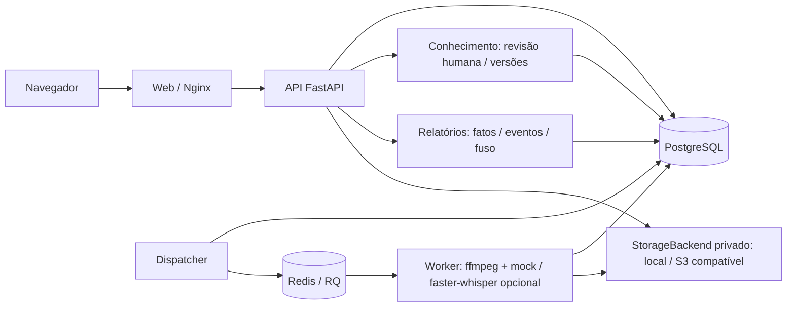

# Arquitetura

## Interface web e compatibilidade da API

SolDesk usa uma única interface React responsiva para computador e navegador
móvel. Android/iOS nativos foram descontinuados. Não há pipeline nativo nem
painel de conexão por deep link; gravação e anexos continuam no navegador.
Tokens centralizados geram a paleta provisória; abas e formulários existentes
servem desktop/celular. Ações principais abrem o registro atual ou a pesquisa
editorial, sem nova rota de negócio. Logo oficial e identidade definitiva pendentes.

AudioCapture detecta MIME, gerencia pausa/interrupção e libera tracks na saída.
Prévia vive em memória (blob URL revogada); formulário mantém chave de criação
durante recuperação de rede e usa deduplicação de áudio já existente no servidor.
Manifesto web é público e estático; desenvolvimento monta `web/public` somente
leitura. Não há service worker nem cache offline de dados autenticados. Ícones
oficiais e instalação PWA homologada pendentes. Pipeline backend permanece igual.

A migração aplicada `0006a` é preservada: `client_kind`, MobileRefreshToken,
RLS por usuário/empresa e hashes de tokens não foram removidos nem alterados.
O contrato legado bearer mantém acesso curto, refresh rotativo/antirreplay e
testes de segurança, independente de SDK nativo. Cookie/CSRF continuam sendo
a autenticação da web. Nenhum modelo de negócio ou horário foi alterado.
Contrato: [sessão por token](docs/API_SESSAO_TOKEN.md).

## Fidelidade do texto

Migração aditiva `0009`, após `0006a`, acrescenta RecordContentVersion e
ContentValidation com RLS FORCE, FKs compostas por organização e proteção
append-only. RecordVersion continua a trilha de todos os eventos; `record_event`
captura também um snapshot material quando texto/contexto/transcrição mudam.
O SHA-256 cobre a representação JSON canônica completa, conferida pelo banco.
Versão material não muda por simples transição operacional. Voltar a um conteúdo
anterior cria outra versão e exige nova validação, mesmo com hash igual.

Validação bloqueia o Record antes de conferir ID/hash correntes, na mesma ordem
da edição e do worker. Evento registra pessoa/data/versão/hash; reenvio pela mesma
pessoa é idempotente. Estado `validado` é derivado da existência de evento para a
versão atual; versões/eventos anteriores permanecem. Processo automático nunca
cria ContentValidation. Áudio de chamado também integra o snapshot, sem precisar
substituir sua descrição ou alterar a resolução. Não há novo serviço ou biblioteca.

Backfill importa somente conteúdo atual, vinculado à versão de origem existente;
não inventa validações nem datas de revisão antigas. Triggers legadas de fatos e
classificação permanecem. Downgrade só remove as tabelas novas quando vazias;
havendo histórico, falha antes de apagá-lo. Interface específica ainda pendente.

## Conhecimento e relatórios

Migração aditiva 0005 amplia KnowledgeArticle e acrescenta ArticleVersion,
ArticleConsultation e Team, com RLS FORCE. FKs compostas protegem cliente/template
e autor/revisor na empresa. Versões/consultas são append-only para o runtime;
triggers protegem origem/autoria/conteúdo publicado e classificação de Record revisado.
Artigos anteriores recebem snapshot de importação sem inventar ator/template histórico.

`knowledge.py` / `knowledge_routes.py`: fluxo editorial humano, revisão otimista
409 e locks Record → artigo, compatíveis com worker. Conteúdo editorial editado
não é sobrescrito pelo processamento. Busca combina tsvector português/GIN,
unaccent/trigramas/GIN e trecho literal de códigos; trigger atualiza índices.
Destaques são offsets de texto renderizados pelo React, sem HTML do banco.
Publicados gerais são o padrão; filtro de cliente acrescenta os restritos daquele
cliente. Origem mantém permissão própria. Consultas guardam artigo/empresa/data,
sem identidade do leitor. Strings em `insight-strings`; UI KnowledgeArea/ReportArea
integrada a WorkArea e cadastro de clientes, com links navegáveis por hash.

`reports.py` / `report_routes.py`: métricas definidas antes do código em
[METRICAS](docs/METRICAS.md), por autoria de Record e ator de TicketEvent.
Calendários no fuso IANA viram limites UTC independentes; mediana/P90/n e pausas
unificadas/recortadas, sem duração presumida. Técnico tem escopo próprio, gestão
consulta a empresa, inclusive no CSV. Equipe/classificação atuais não simulam
histórico passado. Pessoas em ordem alfabética; gráfico tem tabela equivalente.

Agregação inicial em memória limitada a 10 mil registros, 10 mil tickets, 50 mil
eventos, 20 mil intervalos e 50 mil consultas; excesso retorna 422 sem truncar.
Períodos até 3661 dias. Tela pagina histórico em 100; CSV exporta histórico completo
dentro dos limites. Carga de produção exige medição futura. Não há dependência
nova, busca vetorial ou serviço externo. Nome/fuso da organização preservam as
políticas aninhadas de mídia/conhecimento; alterações usam rotas e locks próprios.
Contrato: [API](docs/API_CONHECIMENTO_RELATORIOS.md).

Monorepo: API Python/FastAPI + Pydantic, SQLAlchemy 2 e Alembic; web React,
TypeScript, Vite e Tailwind CSS v4; PostgreSQL 17 no Compose. Sem microserviços
de negócio separados. Contrato OpenAPI disponível em `/docs` e `/openapi.json`.

## Implementado

- `GET /api/v1/health`: testa conexão e presença da instalação; retorna 503
  quando o banco está inacessível ou ainda não migrado.
- `GET /api/v1/server-info`: produto, versão API, UUID persistente, modo,
  capabilities efetivamente disponíveis. Não expõe credenciais ou clientes.
- Migração 0001 cria apenas `installation` (além da tabela técnica do Alembic),
  com restrição singleton e UUID gerado uma vez. API nunca cria tabelas ao subir.
- Erros em `application/problem+json`, CORS com origens explícitas, request ID
  e logs JSON sem corpo, query ou mensagens internas de exceção.
- Web usa proxy de mesma origem, consulta duas rotas reais, possui timeout,
  erro e nova tentativa; nenhum sucesso simulado ou login fictício.
- Fonte de tokens JSON gera CSS web e verifica contraste WCAG.

## Infraestrutura e fronteiras

Compose espera banco saudável, aplica migrações e só então libera API e web.
Banco sem porta no host; API/web vinculadas a 127.0.0.1. Imagens de API e Nginx
usam usuário não root. O perfil dev monta fontes para hot reload.
Scripts não apagam banco ou volumes; preservam o UUID em migrações repetidas.

SQLite é exclusivamente alternativa de desenvolvimento/testes rápidos. Testes
SQLite não comprovam PostgreSQL, RLS ou persistência entre contêineres.
A API usa `soldesk_runtime`, sem superusuário/BYPASSRLS e sem ser dona
das tabelas. Migração/bootstrap usam conexão separada, nunca entregue à API.
`Context.query/get` aplica o tenant da sessão e `set_config(..., true)` define
o contexto por transação. Políticas RLS com FORCE reforçam a separação. Testes
com SQL sem filtro e conexão reutilizada demonstram a barreira no PostgreSQL.

Redis/RQ, dispatcher, worker e `StorageBackend` local/S3 compatível
estão implementados. A API grava recibo durável no PostgreSQL e responde 202 sem
esperar Redis ou transcrição; o dispatcher entrega o trabalho ao RQ. Não há
conectores externos de negócio.

VPS/produção, TLS, backup/restauração e revisão de segurança ainda não validados.
Use apenas dados fictícios até a revisão de produção e segurança do produto.

## Identidade e organização

`Organization`, `User`, `OrganizationMembership`, `Client`, `ClientExternalRef`,
`Invitation` e `AuditEvent` adicionados em migração aditiva 0002. O esquema SQL
é um snapshot congelado, independente de alterações posteriores dos modelos. Datas
TIMESTAMPTZ em UTC; fuso IANA por organização, aplicado na interface.

Sessões opacas (12 h), hashes Argon2id, CSRF sincronizado no servidor, revogação,
convites de uso único e rate limit persistente. Usuário global pode ter vários
vínculos; o ID selecionado não autoriza acesso sem vínculo ativo. Tabelas internas
de autenticação global não têm CRUD público. Redefinição de senha de identidade
compartilhada é limitada para impedir tomada de acesso entre organizações.

Clientes usam unaccent/pg_trgm, índices GIN, nome normalizado único por empresa e
paginação offset. Referências externas são apenas armazenadas, com FK composta
por empresa/cliente. Auditoria administrativa não armazena segredos e o runtime
não recebe permissão para alterar/apagar auditoria.

Papéis e regras: [PERMISSOES](docs/PERMISSOES.md). Contratos e fronteiras:
[API](docs/API_IDENTIDADE.md). Áudio, fila e arquivos estão descritos abaixo; SMTP não implementado.

## Relato, revisão e operação

Migração 0003 aditiva: Record/RecordVersion, Ticket/TicketSequence,
TicketParticipant/TicketComment/TicketEvent/TicketInterval, KnowledgeArticle
(somente rascunho), Notification e RequestReceipt. SQL congelado, FKs por tenant,
RLS FORCE em todas as tabelas novas, leitura de notificações por destinatário.
`work_schemas`, `work`, `work_routes` separam entrada, regras transacionais e HTTP.
O domínio de operação é independente dos jobs de áudio; worker/Redis são descritos abaixo.

Bloqueio da linha e revisão otimista evitam sobrescrita; recibo com hash e
advisory lock transacional evitam criações duplicadas. Comentários, versões e
eventos são apenas incluídos/consultados pelo runtime. O banco protege fatos
originais e conteúdo confirmado com trigger; não há DELETE desses recursos.
Lotes de revisão são atômicos. Somente o autor confirma finalizações.

UI em `WorkArea`, textos em `work-strings`; API real, polling de 15 s, páginas
de registros/revisões/histórico/chamados e três destinos. Conversão de horário
IANA preserva o fato e exige offset em ambiguidades de horário de verão.
Processamento e publicação usam seus fluxos próprios. Contratos:
[API](docs/API_ATENDIMENTOS.md), [estados](docs/ESTADOS.md).

## Arquivos e processamento assíncrono

Migração 0004: Attachment, AudioJob, TemplateVersion e GlossaryTerm, tenant e FKs
compostas/RLS FORCE. Armazenamento privado local por padrão; adaptador boto3 para
S3 compatível. Perfil S3 usa RustFS fixado por digest para reprodutibilidade; endpoint MinIO existente também pode usar o adaptador S3.
URLs HMAC curtas continuam exigindo autorização e a mesma sessão; acesso auditado.

Upload verifica tamanho/assinatura/MIME e salva arquivo + job durável. Dispatcher
reconcilia PostgreSQL com RQ/Redis; worker separado normaliza ffmpeg mono 16 kHz,
verifica duração e chama o provedor. API não contém ffmpeg nem carrega Whisper.
Prioridade urgente, retries com backoff, deadline e lease idempotente; perda da
fila ou worker não bloqueia trabalho textual nem a operação de tickets.

Mock determinístico utiliza só texto humano informado, com identificação de
simulação; não reconhece fala. faster-whisper opcional CPU/int8, modelo local
explícito e downloads desativados na imagem. Contrato futuro de organizador LLM
valida evidência literal; somente regras de marcadores estão ativas.
Templates são versões imutáveis e glossário só normaliza palavras conhecidas.

UI MediaRecorder com consentimento, contador/prévia/cancelamento; upload e
digitação são alternativas. Web Speech é opt-in, desabilitável por empresa,
com aviso de possível envio ao fabricante e sem captura simultânea prometida.
Strings centralizadas em `media-strings.ts`. Conclusão exige conferência humana;
Ticket recebe comentário posterior sem mudar estado. Horários originais imutáveis.
Retenção padrão manter; políticas explícitas removem áudio elegível com auditoria.
Detalhes, limites e contratos: [API](docs/API_MIDIA.md).

## Atendimentos contínuos

Atendimentos contínuos reutilizam `Record`, revisões, anexos e processamento.
`Attendance` é uma extensão operacional: responsável, revisão, estado, próxima
ação, retomada e resultado. A separação impede que transcrição finalize/reabra o
ciclo ou que finalização valide o texto. O ID é o do registro inicial; atualizações
são registros ligados por `origem_record_id`, com fato e revisão próprios.
Transferências/transições usam auditoria existente. Migração `0010` adiciona
RLS forçada, FKs por empresa e marcador interno para ausência de cliente.
Sem serviço ou dependência nova. [Contrato](docs/API_ATENDIMENTOS.md).

## Licenciamento do código

Código próprio sob GNU AGPL v3 somente (`AGPL-3.0-only`). Componentes terceiros
mantêm suas licenças; inventário, condições de redistribuição e limites da revisão
em [docs/LICENCAS.md](docs/LICENCAS.md). A arquitetura permite instalações próprias
e hospedagem comercial, sujeitas à licença e às obrigações de fonte correspondente.

## Interface dos ciclos independentes

AttendanceArea reaproveita estilos e componentes de áudio. Ações principais abrem
Finalização/Em andamento; painel mostra listas paginadas e atualizações com histórico.
TextValidation/ValidationQueue consultam a versão material no servidor e validam
somente após conferência explícita. Conflito/rede mostram erro sem fabricar sucesso;
retry de atendimento mantém a chave e recupera o registro antes de reenviar áudio.
Textos novos estão centralizados em evolution-strings.ts; não há cache offline.
## Catálogo estruturado de sistemas

A migração `0011` acrescenta SoftwareSystem, ClientSystem e SystemReconciliation.
O nome normalizado é calculado no PostgreSQL, com unicidade por organização,
independentemente de caixa, acentos ou espaços extras. Vínculos cliente/sistema
guardam versão em uso e observações. Não há dependência ou serviço novo.

Record, Ticket e KnowledgeArticle recebem `system_id`, `system_name_snapshot` e
`legacy_system_snapshot` opcionais. O campo textual permanece preservado; não há
backfill automático. A reconciliação humana registra decisões imutáveis com ator,
data, revisão e idempotência. Classificação material de Record exige nova validação
de fidelidade e preserva o histórico anterior. Seleções novas rejeitam inativos;
contexto histórico herdado continua válido.

RLS forçada, FKs compostas, bloqueios e revisões protegem empresas e concorrência.
A pesquisa de artigos passa a indexar o instantâneo em novas gravações. A reversão
bloqueia antes de remover estrutura se houver dados novos no catálogo.
[Contrato e evidências](docs/API_SISTEMAS.md). Interface específica pendente.
