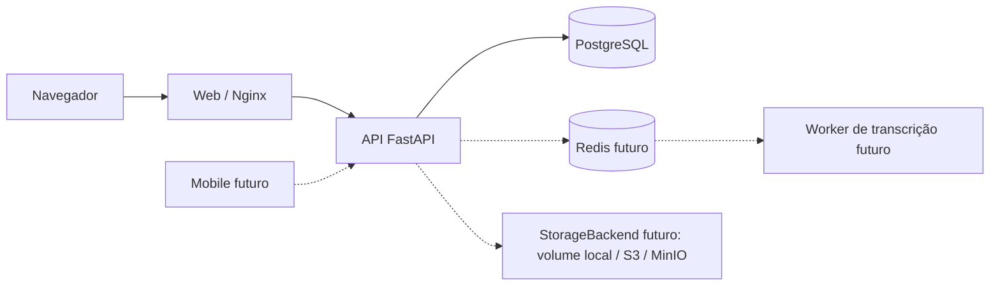

# Arquitetura

Monorepo: API Python/FastAPI + Pydantic, SQLAlchemy 2 e Alembic; web React,
TypeScript, Vite e Tailwind CSS v4; PostgreSQL 17 no Compose. Sem microserviços
de negócio nesta fase. Contrato OpenAPI disponível em `/docs` e `/openapi.json`.

## Implementado

- `GET /api/v1/health`: testa conexão e presença da instalação; retorna 503
  quando o banco está inacessível ou ainda não migrado.
- `GET /api/v1/server-info`: produto, versão API, UUID persistente, modo,
  capabilities efetivamente disponíveis. Não expõe credenciais ou clientes.
- Migração 0001 cria apenas `installation` (além da tabela técnica do Alembic),
  com restrição singleton e UUID gerado uma vez. API nunca cria tabelas ao subir.
- Erros em `application/problem+json`, CORS com origens explícitas, request ID
  e logs JSON sem corpo, query ou mensagens internas de exceção.
- Web usa proxy de mesma origem, consulta duas rotas reais, possui timeout,
  erro e nova tentativa; nenhum sucesso simulado ou login fictício.
- Fonte de tokens JSON gera CSS web e constantes para o mobile futuro.

## Infraestrutura e fronteiras

Compose espera banco saudável, aplica migrações e só então libera API e web.
Banco sem porta no host; API/web vinculadas a 127.0.0.1. Imagens de API e Nginx
usam usuário não root. O perfil dev monta fontes para hot reload.
Scripts não apagam banco ou volumes; preservam o UUID em migrações repetidas.

SQLite é exclusivamente alternativa de desenvolvimento/testes rápidos. Testes
SQLite não comprovam PostgreSQL, RLS ou persistência entre contêineres.
Na fase 02, a API deverá abandonar o papel inicial superusuário de bootstrap,
usar papel runtime separado e tenant por transação, com teste de RLS sem filtro.
Nenhuma entidade de negócio será exposta antes dessas proteções.

Redis e o worker só serão adicionados na fase de áudio. Armazenamento de arquivos
será uma abstração `StorageBackend`, com implementação local e S3/MinIO compatível,
URLs temporárias e auditoria. Não há uploads ou conectores nesta fase.

VPS/produção, TLS, backup/restauração e revisão de segurança ainda não validados.
Não usar esta base com dados reais antes de implementar autenticação e isolamento.

## Licenciamento

Código próprio sob GNU AGPL v3 somente (`AGPL-3.0-only`). Componentes terceiros
mantêm suas licenças; inventário, condições de redistribuição e limites da revisão
em [docs/LICENCAS.md](docs/LICENCAS.md). A arquitetura permite instalações próprias
e hospedagem comercial, sujeitas à licença e às obrigações de fonte correspondente.
