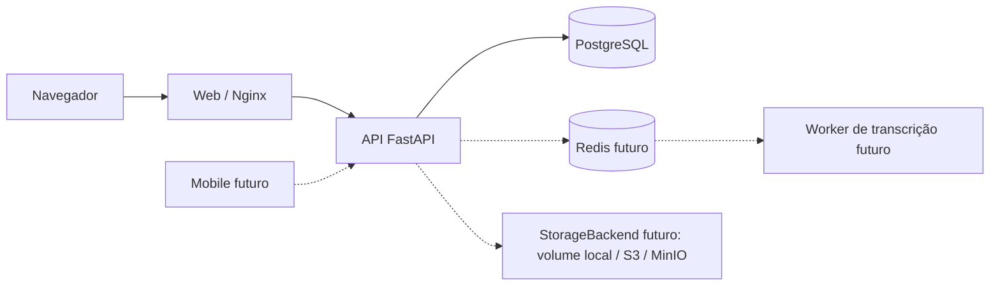

# Arquitetura

Monorepo: API Python/FastAPI + Pydantic, SQLAlchemy 2 e Alembic; web React,
TypeScript, Vite e Tailwind CSS v4; PostgreSQL 17 no Compose. Sem microserviços
de negócio nesta fase. Contrato OpenAPI disponível em `/docs` e `/openapi.json`.

## Implementado

- `GET /api/v1/health`: testa conexão e presença da instalação; retorna 503
  quando o banco está inacessível ou ainda não migrado.
- `GET /api/v1/server-info`: produto, versão API, UUID persistente, modo,
  capabilities efetivamente disponíveis. Não expõe credenciais ou clientes.
- Migração 0001 cria apenas `installation` (além da tabela técnica do Alembic),
  com restrição singleton e UUID gerado uma vez. API nunca cria tabelas ao subir.
- Erros em `application/problem+json`, CORS com origens explícitas, request ID
  e logs JSON sem corpo, query ou mensagens internas de exceção.
- Web usa proxy de mesma origem, consulta duas rotas reais, possui timeout,
  erro e nova tentativa; nenhum sucesso simulado ou login fictício.
- Fonte de tokens JSON gera CSS web e constantes para o mobile futuro.

## Infraestrutura e fronteiras

Compose espera banco saudável, aplica migrações e só então libera API e web.
Banco sem porta no host; API/web vinculadas a 127.0.0.1. Imagens de API e Nginx
usam usuário não root. O perfil dev monta fontes para hot reload.
Scripts não apagam banco ou volumes; preservam o UUID em migrações repetidas.

Na fase 01, setup PowerShell, builds de imagens, Compose/PostgreSQL, migrações
repetidas e reinício com preservação de UUID foram executados em Windows/WSL 2.
O navegador foi testado contra Nginx/API/PostgreSQL, além da suíte SQLite local.
O aceite reproduzível está em `scripts/test-compose.ps1`; o Playwright aceita
`PLAYWRIGHT_BASE_URL` para usar serviços externos sem iniciar API/Vite locais.

SQLite é exclusivamente alternativa de desenvolvimento/testes rápidos. Testes
SQLite não comprovam PostgreSQL, RLS ou persistência entre contêineres.
Na fase 02, a API usa `soldesk_runtime`, sem superusuário/BYPASSRLS e sem ser dona
das tabelas. Migração/bootstrap usam conexão separada, nunca entregue à API.
`Context.query/get` aplica o tenant da sessão e `set_config(..., true)` define
o contexto por transação. Políticas RLS com FORCE reforçam a separação. Testes
com SQL sem filtro e conexão reutilizada demonstram a barreira no PostgreSQL.

Redis e o worker só serão adicionados na fase de áudio. Armazenamento de arquivos
será uma abstração `StorageBackend`, com implementação local e S3/MinIO compatível,
URLs temporárias e auditoria. Não há uploads ou conectores nesta fase.

VPS/produção, TLS, backup/restauração e revisão de segurança ainda não validados.
Use apenas dados fictícios até a revisão de produção e segurança do produto.

## Fase 02: identidade e organização

`Organization`, `User`, `OrganizationMembership`, `Client`, `ClientExternalRef`,
`Invitation` e `AuditEvent` adicionados em migração aditiva 0002. O esquema SQL
é um snapshot congelado, independente dos modelos de futuras fases. Datas
TIMESTAMPTZ em UTC; fuso IANA por organização, aplicado na interface.

Sessões opacas (12 h), hashes Argon2id, CSRF sincronizado no servidor, revogação,
convites de uso único e rate limit persistente. Usuário global pode ter vários
vínculos; o ID selecionado não autoriza acesso sem vínculo ativo. Tabelas internas
de autenticação global não têm CRUD público. Redefinição de senha de identidade
compartilhada é limitada para impedir tomada de acesso entre organizações.

Clientes usam unaccent/pg_trgm, índices GIN, nome normalizado único por empresa e
paginação offset. Referências externas são apenas armazenadas, com FK composta
por empresa/cliente. Auditoria administrativa não armazena segredos e o runtime
não recebe permissão para alterar/apagar auditoria.

Papéis e regras: [PERMISSOES](docs/PERMISSOES.md). Contratos e fronteiras:
[API fase 02](docs/API_FASE_02.md). Mobile, Redis, áudio, SMTP e arquivos continuam
fora desta fase.

## Licenciamento

Código próprio sob GNU AGPL v3 somente (`AGPL-3.0-only`). Componentes terceiros
mantêm suas licenças; inventário, condições de redistribuição e limites da revisão
em [docs/LICENCAS.md](docs/LICENCAS.md). A arquitetura permite instalações próprias
e hospedagem comercial, sujeitas à licença e às obrigações de fonte correspondente.
