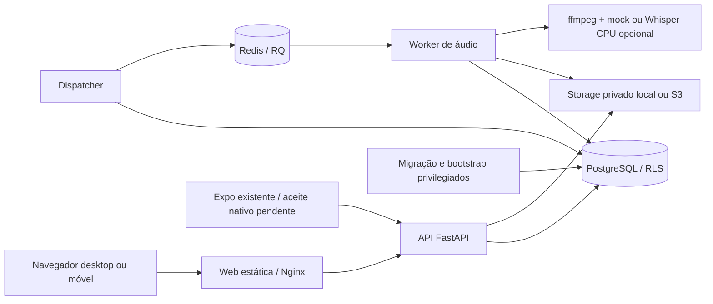

# SolDesk — auditoria técnica e plano de evolução

> Registro histórico anterior à descontinuação do cliente nativo em
> 16/11/2026. Referências a aplicativo, Expo e aceite Android descrevem
> aquele estado; não são instruções de instalação ou pendências atuais.

Data: 16/11/2026. Escopo: árvore local de trabalho, incluindo alterações ainda não
commitadas da Parte A/06. Referência local HEAD: `e4fa8bb`, branch main, origem
configurada para o repositório oficial. O conteúdo atual do GitHub não foi consultado
nem comparado nesta auditoria; não presumir que contenha as alterações locais.

**Evidências:** **C** = confirmado por código/configuração inspecionados;
**T07** = confirmado por teste/verificação executado nesta auditoria;
**D** = declarado na documentação, inclusive resultados de execuções anteriores;
**NV** = não verificado. Propostas são planejamento, não implementação existente.

## 1. Resumo executivo

O SolDesk possui um núcleo web funcional e reaproveitável: clientes, equipe,
autenticação, isolamento por organização, registros, chamados, histórico,
anexos privados, processamento de áudio, conhecimento versionado e relatórios.
A auditoria não indica necessidade de reescrita ou de trocar a arquitetura.

A premissa de que os seis prompts estão integralmente encerrados não se confirma:
[STATUS](../STATUS.md) e [validação 06A](VALIDACAO_PROMPT_06A.md) registram aceite
Android pendente e Parte B não iniciada. Conectores mock, fechamento de segurança
e revisão LGPD dessa parte não foram encontrados no código. O app existe localmente,
mas não é requisito para a evolução web solicitada. Recomenda-se adiar seu aceite
por decisão explícita de escopo, sem registrá-lo retroativamente como aprovado.

O sistema **ainda não deve receber dados reais do piloto** antes de homologar HTTPS,
backup/restauração, políticas de acesso/retenção e capacidade. Não foi demonstrada
uma exploração crítica nesta auditoria; isso não equivale a certificação de segurança.
Transcrição real com Whisper continua **NV**: o provedor padrão é um mock que
reutiliza o relato digitado e não reconhece fala.

Nesta etapa foi produzido apenas este relatório. Nenhum código, configuração de
serviço ou documento anterior foi alterado. Sem deploy, commit, push, modelos novos,
acesso a instância Nextcloud ou migração da instalação. Testes com escrita ficaram
restritos ao banco/Redis de testes e seus dados fictícios.

## 2. Arquitetura existente e inventário

### Componentes e versões

| Componente | Confirmado no projeto | Observação |
|---|---|---|
| Backend | Python >=3.12 declarado; imagem/CI Python 3.13; ambiente local 3.13.16 | C/T07. Compatibilidade com 3.12 não revalidada. [pyproject](../backend/pyproject.toml), [Dockerfile](../backend/Dockerfile). |
| API | FastAPI 0.163.1, Pydantic 2.14.3, Uvicorn 0.54.0 | C: lock; T07: contrato local com 62 caminhos e 78 operações HTTP. [lock](../backend/requirements.lock). |
| Persistência | SQLAlchemy 2.0.57, Alembic 1.20.1, psycopg 3.3.9, PostgreSQL 17 | C/T07. SQLite serve somente à instalação mínima/testes, não ao negócio. |
| Web | React/ReactDOM 19.3.1, TypeScript 6.0.3, Vite 6.4.6, Tailwind 4.3.5 | C: versões resolvidas no [lock web](../web/package-lock.json), não apenas faixas do manifesto. |
| Testes | pytest 9.2.0, Vitest 5.1.0, Playwright 1.65.1 | C/T07. [CI](../.github/workflows/checks.yml). |
| Fila | Redis 8, redis-py 8.1.0, RQ 2.12.0; dispatcher próprio | C. Recibo durável no PostgreSQL e fila JSON com IDs, sem texto do relato no payload. |
| Áudio | ffmpeg/ffprobe no worker; faster-whisper 1.2.1/CTranslate2 4.9.0 opcionais | C; reconhecimento real NV. [lock opcional](../backend/requirements-whisper.lock). |
| Servidor web | Nginx unprivileged 1.28-alpine; Node 22 no build | C. Node não é servidor necessário na entrega web estática. |
| Mobile preexistente | Expo 58.0.25, React Native 0.88.1, React 19.3.0 | C; não desenvolvido nem iniciado nesta auditoria. manifesto nativo histórico (retirado). |
| Licença | Código próprio AGPL-3.0-only | C. [LICENSE](../LICENSE) e [inventários/condições](LICENCAS.md). Não foram relicenciadas dependências. |

Estrutura: [backend](../backend/) contém API, modelos, migrações e testes;
[web](../web/) contém SPA, Nginx e testes; cliente nativo histórico (retirado) é cliente opcional;
[scripts](../scripts/) reúne setup, demonstração e verificações;
[docs](./) concentra contratos e evidências; [infra](../infra/) contém orientação.
Parte do texto em [infra/README](../infra/README.md) ainda descreve separação de
papéis como futura, embora ela já exista: documentação defasada.

[Compose](../compose.yaml) mantém PostgreSQL e Redis sem porta publicada. Web/API
usam loopback por padrão; API aceita binding LAN explícito. Volumes persistem banco,
mídia, Redis e S3 opcional. Migrações 0001–0006a são incrementais; a consulta SQL
**somente leitura** confirmou 0006a na instalação local e runtime sem superusuário
ou BYPASSRLS. Não foram executadas migrações nessa instalação.

**Independência:** web + API + PostgreSQL sustentam trabalho textual; áudio é
assíncrono e não impede abrir/resolver chamados. Storage local dispensa S3;
transcrição pode ser desabilitada; não exige IA paga, GPU ou Nextcloud. O setup
atual ainda inicia Redis/dispatcher mesmo com transcrição desligada: reduzir a
topologia exige decisão/configuração futura, não ocorre automaticamente. Dev
Vite, testes, Expo, S3, antivírus e Whisper não são todos serviços obrigatórios.

### Verificações executadas nesta auditoria

| Verificação segura | Resultado T07 |
|---|---|
| `docker compose --profile test run --no-deps --rm --pull never tests` | **72 aprovados**, 85,97 s, sem skips; PostgreSQL/Redis dedicados. Um aviso upstream Starlette/httpx. |
| Ruff check e format --check | Aprovados; sem correção automática. |
| Web lint, formatação, Vitest, TypeScript/Vite | Aprovados; **6 testes**, build gerado. |
| Playwright somente instalação, Edge desktop/emulação móvel | **4 aprovados**, 11,9 s; saúde/identidade/layout e falha simulada no navegador. |
| Mobile TypeScript/lint e testes Node preexistentes | Aprovados; **32 testes** de conexão/sessão. Sem iniciar Android/iOS. |
| Tokens e contraste | **32 pares** aprovados, fontes geradas sem deriva. |
| Limite de anexo | Configuração de 80 MiB recusada: teto observado de 67.108.864 bytes. Sem enviar arquivo grande. |
| Editor, saúde local e metadados de banco | Sem diagnósticos; API saudável; esquema 0006a e papel restrito confirmados. |
| Padrões locais de segredos | Nenhuma correspondência nos padrões examinados; arquivos privados ignorados fora da lista candidata ao Git. Não é auditoria exaustiva de segredos. |

Os 34 E2E autenticados, dois E2E da prévia Expo, Expo Doctor e auditorias npm sem
achados são **D nesta auditoria**, registrados na execução da Fase 06A. Não foram
reexecutados os fluxos que param worker, alteram políticas ou criam dados na instalação.
`pip-audit`, gitleaks completo, auditoria atual de CVEs/imagens, carga, recuperação,
certificados de produção, dispositivos físicos e Nextcloud real são **NV**. Não
se consultaram registries de vulnerabilidade nem serviços empresariais externos.

## 3. Funcionalidades existentes — avaliação individual

“Implementada” descreve o escopo existente; não significa que todas as evoluções
pedidas neste Prompt 07 já estejam presentes. A coluna de teste aponta casos
incluídos na suíte T07; testes de navegador de negócio permanecem D.

| # | Funcionalidade | Situação | Evidência e limites |
|---|---|---|---|
| 1 | Cadastro de clientes | **Implementada** | C/T07: CRUD sem exclusão pública, busca por nome/apelido, inativação e referências externas. [routes](../backend/app/routes.py#L482), [teste de isolamento/cadastro](../backend/tests/test_identity.py#L115). Sem CSV/sync. |
| 2 | Cadastro de sistemas | **Parcialmente implementada** | C: campo livre system em registros/chamados/artigos; não há entidade/catálogo nem vínculo cliente-sistema. [schemas](../backend/app/work_schemas.py#L33). |
| 3 | Cadastro de técnicos | **Implementada** | C/T07: usuários/vínculos, convites, senha temporária e papéis. [rotas de equipe](../backend/app/routes.py#L252), [testes de identidade](../backend/tests/test_identity.py). Sem SMTP obrigatório. |
| 4 | Autenticação | **Implementada** | C/T07: Argon2id, sessões, CSRF, expiração, revogação, bloqueio progressivo; bearer mobile separado. [security](../backend/app/security.py), [testes mobile](../backend/tests/test_mobile.py). Sem SSO/MFA. |
| 5 | Permissões por usuário | **Implementada, por papéis** | C/T07: administrador/gestor/técnico e escopo de chamados/registros. [access](../backend/app/access.py), [work](../backend/app/work.py#L47), [testes RLS](../backend/tests/test_identity.py#L158). Sem ACL arbitrária por cliente/campo. |
| 6 | Abertura de chamados | **Implementada** | C/T07: criação normal/urgente, sequência por organização, sem aguardar revisão. [rotas](../backend/app/work_routes.py#L213), [teste](../backend/tests/test_work.py#L190). |
| 7 | Atribuição de responsáveis | **Implementada** | C/T07: membro ativo, transferência, participantes e notificação. [work](../backend/app/work.py#L492), [teste](../backend/tests/test_work.py#L267). Equipe não é destinatário operacional do Ticket. |
| 8 | Atualização de chamados | **Implementada** | C/T07: comentários, esclarecimento/resposta, prioridade, estados, revisão otimista e eventos. [work](../backend/app/work.py#L526). Prazo e aceite formal de conclusão ausentes. |
| 9 | Finalização de atendimentos | **Implementada no fluxo atual** | C/T07: Record finalizacao, revisão exclusiva do autor, horários separados e confirmação. [work](../backend/app/work.py#L410), [teste](../backend/tests/test_work.py#L61). Sem atividade interna sem cliente. |
| 10 | Histórico dos clientes | **Implementada** | C/T07: paginação, finalizações confirmadas por padrão e opção de provisórios autorizados. [rota](../backend/app/work_routes.py#L187), [teste](../backend/tests/test_work.py#L61). |
| 11 | Upload de anexos | **Implementada com limites** | C/T07: privados, validação de formato, checksum e acesso assinado/autenticado. [media_routes](../backend/app/media_routes.py#L159), [teste](../backend/tests/test_media.py#L127). 25 MiB padrão, teto 64 MiB; 80 MB não suportados. |
| 12 | Base de conhecimento | **Implementada** | C/T07: campos estruturados, autoria, revisão editorial, publicação, versões, devolução e arquivo. [knowledge](../backend/app/knowledge.py), [teste](../backend/tests/test_knowledge_reports.py#L82). Sem revalidação técnica periódica. |
| 13 | Pesquisa textual | **Parcialmente implementada quanto ao escopo futuro** | C/T07: clientes e artigos; FTS português, trigramas/literal nos artigos. [busca](../backend/app/knowledge.py#L297), [teste](../backend/tests/test_knowledge_reports.py#L179). Não é busca global de chamados/atendimentos/sistemas. |
| 14 | Transcrição de áudio | **Parcialmente implementada** | C/T07: upload e contrato, mock testado; adapter faster-whisper CPU existe. [providers](../backend/app/transcription.py#L178). Reconhecimento real/precisão com pesos: NV. |
| 15 | Processamento de transcrições | **Implementada com mock** | C/T07: fila, normalização, retries, lease, timeout, avisos e revisão. [worker](../backend/app/media_worker.py), [testes](../backend/tests/test_media.py#L101). Validação independente ainda ausente. |
| 16 | Templates de texto | **Implementada** | C/T07: versões/snapshots, marcadores e glossário. [RulesOrganizer](../backend/app/transcription.py#L111), [teste](../backend/tests/test_media.py#L300). Não há organizador LLM ativo. |
| 17 | Relatórios | **Implementada com limites** | C/T07: períodos/fuso, ações por ator, mediana/P90, pausas, equipes e CSV. [reports](../backend/app/reports.py), [testes](../backend/tests/test_knowledge_reports.py#L285). Sem painel de prazos/tarefas. |
| 18 | Tarefas e agendamentos | **Não implementada** | C: não há modelos/rotas/telas de negócio. AudioJob, dispatcher e croniter não constituem tarefas de usuário ou calendário. |
| 19 | Notificações | **Implementada, interna** | C/T07: destinatário, polling e marcação de leitura. [rotas](../backend/app/work_routes.py#L312), [teste](../backend/tests/test_work.py#L381). Sem push/e-mail/calendário externo. |

## 4. Funcionalidades ausentes e prioridades

P0 = condição anterior ao piloto com dados reais; P1 = núcleo do novo MVP;
P2 = evolução posterior/opcional. Não são tarefas executadas nesta auditoria.

| Lacuna | Prioridade | Reutilização e mudança necessária |
|---|---|---|
| HTTPS homologado, backup e restauração ensaiada, política de dados | P0 | Aproveitar volumes e scripts; criar operação verificável e critérios de recuperação. |
| Proteção de recursos e observabilidade | P0 | Reforçar proxy, limites, limpeza de sessões/CSRF e eventos de segurança. |
| Validação independente/versionada do conteúdo | P1 | Reutilizar RecordVersion, AudioJob e autorização; separar revisão do conteúdo da resolução. |
| Atividade interna e atendimento contínuo | P1 | Cliente hoje obrigatório; adicionar contexto interno explícito e agregado Attendance com atualizações preservadas. |
| Catálogo de sistemas | P1 | Criar SoftwareSystem/ClientSystem por organização; preservar system textual legado sem fusão automática. |
| Tarefas e calendário interno | P1 | Reutilizar equipe, Notification, UTC e permissões; entidades próprias, sem disfarçar tarefa como Ticket. |
| Prazo, inatividade e aceite de chamado | P1 | Ampliar Ticket/Event/Interval; definir responsável pelo aceite e contagem objetiva de inatividade. |
| Importação CSV e identidade externa | P1 para o piloto | Reutilizar Client/ClientExternalRef; staging, preview, idempotência e política de campos. |
| Upload de pelo menos 80 MB | P1 antes de habilitar esse requisito | Alterar cadeia de limites e implementar processamento com memória limitada/quotas, não só aumentar variável. |
| Busca global e provisórios identificados | P1 | Expandir FTS/trigramas, preservar filtros de acesso e prioridade literal de códigos. |
| Revalidação de procedimentos | P1 | Novo evento de verificação técnica ligado à versão, sem reescrever publicação anterior. |
| Nextcloud/CalDAV e SSO | P2, opcionais | Adapter desacoplado; nenhuma dependência obrigatória do piloto empresarial na edição pública. |
| Busca semântica e por áudio | P2 | Medir ganho primeiro; compartilhar serviço de transcrição, sem modelos extras nesta auditoria. |
| Instalador Linux de versão estável | P1 para distribuição; após contrato operacional | Aproveitar setup.sh; acrescentar release, requisitos, upgrade, backup e rollback. |

## 5. Problemas técnicos encontrados

### Críticos para adoção com dados reais

Não se confirmou falha crítica explorável de isolamento ou autenticação nos testes
executados. Os bloqueadores operacionais são: **ausência de recuperação demonstrada**
e **produção HTTPS/segurança/privacidade não homologada**. Volumes persistentes não
são backup. A configuração HTTP local é adequada ao desenvolvimento, não evidência
de uma implantação empresarial segura.

### Importantes

1. **80 MB bloqueados — C/T07.** [Settings](../backend/app/config.py#L28) limita a
   64 MiB; [Nginx](../web/nginx.conf#L7) também. O teste em memória recusou 80 MiB.
2. **Memória e bloqueio em uploads — C, impacto sob carga NV.**
   [receive_file](../backend/app/media_routes.py#L159) acumula bytearray, copia para bytes
   e chama armazenamento/antivírus síncronos dentro do fluxo async; o download
   também lê o objeto inteiro. Não há quota por empresa, limite global de uploads
   concorrentes ou streaming completo ponta a ponta.
3. **Timeout do web — C.** [media-api](../web/src/media-api.ts) encerra upload em
   60 s. Um arquivo de 80 MiB a 10 Mbit/s já exige aproximadamente 67 s só em dados;
   cálculo teórico, não medição. Aumentar tamanho sem rever timeout/reenvio é insuficiente.
4. **Rate limit e proxy — C; impacto operacional inferido.** O Nginx não encaminha
   X-Forwarded-For; [throttle](../backend/app/security.py) usa request.client.host.
   Clientes pelo proxy podem compartilhar o limite por IP. Corrigir confiança em
   proxies conhecidos sem aceitar cabeçalhos arbitrários do público.
5. **Emissão/limpeza de CSRF e sessões — C.** [csrf](../backend/app/routes.py#L84)
   grava grant até sem login, sem limitador próprio identificado. Não foi encontrado
   serviço de expurgo de grants/sessões expirados. Risco de crescimento e abuso;
   não foi feito teste de exaustão.
6. **Relatórios carregam histórico antes do período — C.**
   [load_facts](../backend/app/reports.py#L121) limita registros/tickets a 10 mil,
   eventos a 50 mil e intervalos a 20 mil; [report](../backend/app/reports.py#L385)
   recorta datas depois. Um período curto pode falhar por volume histórico. Evita
   truncamento silencioso, mas exige agregação SQL/índices e medição futura.
7. **Validação acoplada — C/T07.** Só autor confirma finalização; conteúdo confirmado
   é bloqueado e histórico padrão depende dessa confirmação. [work](../backend/app/work.py#L410)
   e triggers não atendem à validação por qualquer leitor autorizado pretendida no 07.
8. **Referência externa sem unicidade — C.** [ClientExternalRef](../backend/app/models.py#L116)
   não garante identidade externa única. [save_client](../backend/app/routes.py#L482)
   substitui referências em cada edição. Um importador ingênuo pode duplicar vínculos
   ou sobrescrever campos locais. Não existe sincronização pronta.
9. **Coordenação de migrações — C; corrida não reproduzida.** Em
   [migrate](../backend/app/manage.py#L24), o advisory lock transacional da preparação
   termina antes do command.upgrade. Não protege toda a migração contra instaladores
   simultâneos. Recomenda-se executor único/lock que cubra o procedimento completo.
10. **Saúde não comprova revisão completa — C.** [health](../backend/app/main.py)
    verifica conexão/Installation; não valida compatibilidade do head nem todos
    os subsistemas. Manter liveness separado de readiness e saúde da fila.
11. **Dados de relato duplicados na auditoria — C.**
    [record_event](../backend/app/work.py#L156) copia snapshot para RecordVersion e
    before/after de AuditEvent. Logs HTTP omitem corpos, mas isso não elimina dados
    sensíveis do histórico de negócio. Retenção/exportação/exclusão precisam cobrir
    todas as cópias e backups.

### Melhorias opcionais ou após medição

- [FasterWhisperProvider](../backend/app/transcription.py#L210) é criado dentro de
  cada job; o Worker RQ usa processos filhos. Um cache de módulo simples não garante
  modelo quente entre jobs. Avaliar processo de inferência persistente limitado,
  preservando timeout e isolamento, somente após benchmark.
- Dispatcher consulta periodicamente organizações/jobs; listas e relatórios têm
  consultas relacionadas por item. Medir SQL, backlog e índices antes de otimizar.
- Healthcheck do worker importa o módulo completo, que inclui inicialização de
  segurança/Argon2; avaliar probe leve. Não foi quantificado o custo desse probe.
- Imagens por tags mutáveis e dependências de desenvolvimento no lock comum da
  imagem aumentam variabilidade/superfície. Preparar artefatos mínimos reproduzíveis.
- Testar runtime mínimo declarado, Linux limpo/ARM quando suportado e acessibilidade
  além de largura/contraste. Modularizar telas grandes gradualmente, sem reescrita.

## 6. Segurança e infraestrutura

**Controles confirmados C/T07:** Argon2id, senha mínima, cookie HttpOnly/SameSite e
Secure quando production, CSRF, bloqueio progressivo, revogação; sessões mobile
rotativas separadas; contexto autenticado de organização, RLS FORCE e FKs compostas;
testes de acesso cruzado e conexão reutilizada; revisão otimista/idempotência;
uploads com assinatura/MIME/extensão/tamanho; paths internos aleatórios; download
HMAC com sessão/autorização; CSP e nosniff; API/web sem root; JSON na fila em vez
de pickle; logs HTTP sem corpo/query. Essas garantias são delimitadas pelos testes,
não por análise formal ou pentest completo.

**Acesso real:** todos os membros ativos acessam clientes da organização. Técnicos
têm restrições adicionais em registros/chamados; gestores/admin têm alcance maior.
Filtro de cliente em conhecimento não é ACL confidencial entre membros. Confirmar
essa política com o piloto antes de carregar a base empresarial.

**Lacunas:** MFA/SSO, quotas de armazenamento, concorrência de upload/inferência,
limitação de endpoints caros, expurgo, revisão CVE/imagens, gestão/rotação de
segredos, auditoria de eventos de autenticação, alertas e resposta a incidente.
Sem comprovação de criptografia de disco/backups. ClamAV é opt-in: seu teste de
protocolo não certifica daemon/assinaturas reais. Não há segredos de conectores
criptografados porque esses conectores ainda não existem.

**Anexos >=80 MB:** definir MB decimal ou MiB; reservar margem de transporte no
proxy, separar limite de anexos do de áudio e manter duração de áudio independente.
Planejar streaming para arquivo temporário privado ou multipart S3 autenticado,
checksum incremental, antivírus assíncrono/quarentena, publicação após aceite técnico,
quotas por empresa/usuário, limite de concorrência e limpeza de uploads incompletos.
Manter estado técnico do arquivo separado da revisão humana da transcrição.
Download também precisa streaming e autorização por objeto. Não expor bucket público.
Testar exatamente abaixo/no/acima do limite, upload interrompido, concorrência,
disco cheio, vírus simulado, empresa alheia, timeout e recuperação — em ambiente isolado.

**Backup/restauração:** planejar cópia consistente de PostgreSQL + objetos +
configuração/chaves necessárias, criptografada e fora do host; retenção e RPO/RTO
aprovados. Ensaiar restauração em outro projeto Compose e volumes novos, verificar
checksums, referências, login, histórico e isolamento. Não restaurar sobre produção
para testar. Redis é fila auxiliar reconciliada a partir do banco, não substitui
backup dos fatos. Downgrade destrutivo não é estratégia de rollback.
As alternativas de dump, backup físico e recuperação por WAL devem seguir o
[manual de backup do PostgreSQL 17](https://www.postgresql.org/docs/17/backup.html).

**Privacidade:** elaborar inventário e rascunho LGPD antes do piloto: contatos,
relatos, áudios, auditoria, cópias, finalidade, acesso, retenção e exportação/exclusão.
Isso inclui entrada por voz e fornecedor de ditado do navegador, quando ativado.
Definir responsabilidades Community/hospedagem e preservar obrigações AGPL.

## 7. Desempenho e processamento de áudio

### Fluxo atual

API salva registro e objeto privado; AudioJob durável no PostgreSQL; dispatcher
entrega ao Redis/RQ; worker decodifica com ffprobe/ffmpeg, mono 16 kHz, com timeout
e duração limitada; provedor transcreve; glossário normaliza termos; RulesOrganizer
organiza marcadores ou conserva texto integral; resultado guarda segmentos,
incertezas e metadados; revisão humana precede confirmação/publicação.

Mock é local e determinístico, sem fala reconhecida. O adapter real usa
**CPU/int8**, duas threads por padrão, um worker do modelo, idioma português e
pesos locais, sem download automático. GPU não está selecionada. Erros permanentes
ou transitórios têm códigos, tentativas limitadas/backoff, lease, descarte e retry
manual; texto e operação urgente continuam independentes. [worker](../backend/app/media_worker.py),
[providers](../backend/app/transcription.py), [mídia](../backend/app/media.py).

**Serviço único futuro:** reutilizar o contrato TranscriptionProvider para registro,
procedimento e consulta por voz. AudioJob hoje exige Record/Attachment/Template;
consulta por voz precisa propósito próprio, usuário/empresa, retenção curta e não
criar atendimento fictício. Transcrever → mostrar texto editável → pesquisar com
as mesmas permissões. Limitar duração/concorrência, priorizar consultas curtas sem
privar a fila de registros. Não exige três modelos nem um LLM organizador.

### Medição realizada e limites

Duas fotografias de docker stats, **não benchmark**, observaram aproximadamente:
web 6,9 MiB, API 90 MiB, PostgreSQL 64–68 MiB, Redis 12–13 MiB, dispatcher 71 MiB,
worker mock 61–117 MiB. Soma dos serviços principais: cerca de 410–463 MiB,
excluindo host, Docker/WSL, cache, serviços dev/test e picos. O worker variou de
0% a 116% de CPU entre amostras; não se determinou a causa nem carga representativa.
Não usar esses números como capacidade, pico ou consumo de Whisper.

Argon2 configurado em execução: 65.536 KiB por operação, time_cost 3, paralelismo
4. Autenticações concorrentes também consomem recursos; a aplicação precisa de
limitação além de contagem de requisições. Upload de 80 MiB, no caminho atual,
exige pelo menos cerca de 160 MiB só para dois buffers completos; concorrência
multiplica esse valor. Estimativa estrutural, não medição de pico.

| Ambiente | Orçamento inicial estimado, não requisito medido | Orientação |
|---|---|---|
| Notebook com 8 GB | Reservar cerca de 2–3 GB ao ambiente Docker, conforme uso do host | Mock/desabilitado; evitar dev+test+Expo+Whisper simultâneos; sem emulador no caminho web. |
| VPS de teste | 2 vCPU, 2–4 GB RAM, SSD e espaço para mídia | Começar sem ASR; medir uploads, SQL e backlog com dados fictícios. |
| Pequena equipe em produção | 4 vCPU, 4–8 GB RAM, SSD, backup externo | Ponto de partida para homologação, sem promessa de usuários/latência. Reservar mais capacidade ou worker separado se ASR. |

O perfil Whisper limita o contêiner a 3 GiB/2 CPUs, mas isso **não prova** que um
modelo escolhido caiba ou cumpra latência. Para CPU/RAM menores: modelo pequeno
adequado ao português, quantização, um job por vez, duração limitada, inferência
sob demanda e reaproveitamento do modelo após medir. Semântica deve ser opcional,
indexada incrementalmente fora da API. Não foram instalados modelos nesta etapa.
No Windows, os 8 GB são também o mínimo de RAM do host informado pelo
[Docker Desktop](https://docs.docker.com/desktop/setup/install/windows-install/);
isso não significa que toda essa memória possa ser dedicada aos contêineres.

## 8. Plano de evolução do MVP

Todas as seções abaixo são **propostas**, sujeitas a aprovação.

### Cinco fluxos, preservando a estrutura atual

| Fluxo | Reuso e adaptação proposta |
|---|---|
| Finalização | Manter Record/versões/áudio; persistir antes de validar, mostrar estado provisório e permitir validar depois. Acrescentar contexto interno explícito: não criar cliente fictício para atividade interna. |
| Em andamento | Attendance leve como agregado, com atualizações de conteúdo append-only ligadas a registros, próxima ação/data, responsável e fechamento posterior. Não tratar rascunho de transcrição como atendimento em andamento. |
| Chamados | Reusar Ticket, participantes, comentários, eventos e esperas; acrescentar prazo, última atualização relevante, envio para aceite, devolução e conclusão. Definir quem aceita e quando reabrir. Transcrição validada não resolve chamado. |
| Tarefas | Task própria: descrição, usuário ou equipe, cliente opcional, data/prioridade/status; conclusão simples auditada. Task técnica de fila e tarefa de negócio são diferentes. |
| Conhecimento | Reusar KnowledgeArticle/ArticleVersion e revisão humana. Acrescentar evento de revalidação técnica ligado à versão e contexto/sistema, com autor/data/resultado, preservando verificações anteriores. |

Campos system atuais devem receber vínculo opcional com SoftwareSystem/ClientSystem,
preservando texto legado até revisão de cadastro. Record.client_id e pressupostos
de histórico/template/FKs são hoje obrigatórios: atividade interna requer mudança
coordenada em API, SQL, RLS, relatórios e telas, por migração aditiva testada.

### Validação de transcrição independente

Não reutilizar Attachment.validated: é validação técnica do arquivo, não humana.
Não substituir AudioJob.status, que precisa manter erro/fila/descarte. Propor
revisão de conteúdo versionada e atestação append-only vinculada ao conteúdo exato:

| Apresentação | Regra futura |
|---|---|
| Processando | Há job ativo; registro já salvo. Erros permanecem visíveis com mensagem própria. |
| Não validado | Conteúdo disponível, sem atestação da versão atual; continua visível/pesquisável somente para quem tem autorização de leitura. |
| Validado | Usuário autorizado atestou a versão/hash atuais; guardar quem criou, corrigiu, validou e respectivas datas. |

Qualquer usuário que tenha autorização de consulta poderá validar conforme a nova
regra solicitada; servidor continua verificando tenant/acesso ao objeto. Edição
posterior cria nova revisão e invalida somente a atestação corrente, mantendo a
anterior no histórico. Separar versão de conteúdo da revisão operacional do Ticket:
mudar responsável não deve invalidar uma transcrição inalterada. Preservar ocorrido_em
e enviado_em; usar data própria de validação. Migração de conteúdo legado não deve
inventar validações ausentes. Ajustar author_only e triggers de forma explícita,
sem liberar sobrescrita de fatos ou versões já atestadas.

### Interface web e calendário

Reaproveitar React, strings pt-BR, tokens, formulários, paginação e componentes de
mídia. Painel do técnico: **Abrir atendimento** e **Pesquisar**, com resumos de
andamentos, chamados, tarefas e validações. Gestão: filas por estado/responsável,
sem atualização, vencimentos, tarefas e relatórios factuais, sem ranking de técnicos.

Calendário interno com CalendarEvent e vínculos a Task/Attendance/Ticket. Distinguir
prazo de tarefa de compromisso com início/fim; preservar datas de dia inteiro sem
converter indiscriminadamente para meia-noite UTC. Eventos com horário usam UTC e
fuso IANA; recorrência e múltiplos calendários podem vir depois do MVP simples.
Responsividade e acessibilidade devem ser testadas em navegador móvel real;
Android/iOS nativo não entra nesta evolução.

### Pesquisa

1. Expandir pesquisa PostgreSQL para entidades autorizadas de cliente, sistema,
   atendimento, chamado e procedimento, com tipos e estados identificados.
2. Priorizar código/identificador literal, preservando pontuação e zeros; depois
   FTS português e aproximação por trigramas. Busca aproximada em artigos existe;
   clientes hoje usam substring normalizada, não fuzzy global.
   Trigramas ignoram caracteres não alfanuméricos: manter a via literal separada
   é necessário para distinguir códigos técnicos. [Referência PostgreSQL](https://www.postgresql.org/docs/17/pgtrgm.html).
3. Provisórios podem aparecer com aviso e vínculo à versão; nenhum resultado de
   organização alheia ou rascunho privado deve entrar por ranking/embedding.
4. Semântica local só após medir ganho com consultas fictícias: modelo pequeno,
   licença revisada, vetores por organização/versão, indexação assíncrona e invalidação
   após edição. Sem escolher/baixar modelo ou adicionar extensão nesta auditoria.
5. Voz usa o mesmo transcritor e permite conferir a consulta antes da busca. Sem OCR.

### Nextcloud opcional — viabilidade

Viável como integração posterior por **CalDAV/iCalendar**, com tarefas VTODO e
compromissos VEVENT. O projeto Tasks declara sincronização CalDAV; suporte real
depende da versão, apps, ACLs e configuração da empresa, todos NV nesta auditoria.
Fontes: [Nextcloud Tasks](https://github.com/nextcloud/tasks/),
[provedores de calendário](https://docs.nextcloud.com/server/stable/developer_manual/digging_deeper/groupware/calendar_provider.html),
[CalDAV RFC 4791](https://www.rfc-editor.org/info/rfc4791/).

Começar com exportação unilateral de calendário escolhido; só depois permitir
retorno/edição externa. Guardar mapeamento por organização, UID/href, ETag e revisão;
usar escrita condicional e sync-token quando suportado; conflitos exigem decisão,
sem sobrescrever eventos ou apagar fatos locais automaticamente. Outbox PostgreSQL,
retries limitados, status de sincronização e falha isolada do serviço central.
[WebDAV Sync RFC 6578](https://www.rfc-editor.org/rfc/rfc6578.html).

Credencial dedicada revogável pode ser obtida pelo Login Flow v2, armazenada
criptografada no servidor e restrita pela conta/ACL do calendário. Login Flow é
autorização de um cliente Nextcloud, não SSO pronto para o SolDesk. Para SSO, avaliar
OIDC com provedor comum ou app de identidade compatível. OAuth2 padrão do Nextcloud
não deve ser presumido como login de escopo reduzido: a documentação alerta para
acesso amplo e ausência de scopes. Fontes: [Login Flow](https://docs.nextcloud.com/server/stable/developer_manual/client_apis/LoginFlow/index.html),
[OIDC](https://docs.nextcloud.com/server/stable/admin_manual/configuration_user/user_auth_oidc.html),
[OAuth2 e riscos](https://docs.nextcloud.com/server/stable/admin_manual/configuration_server/oauth2.html).

Adapter só no backend, desligado por padrão; segredo nunca na UI/log, criptografia
com chave externa ao banco, rotação, allowlist de destinos e proteção contra SSRF/
redirecionamento de credenciais. Mapear identidade por issuer+subject, não promover
papéis por e-mail/domínio sem regra aprovada. Manter login local de contingência.
Não copiar integrações de empregadores nem acessar Nextcloud real para validar.

### Base existente de clientes

Cadastro interno permanece fonte independente. Primeiro caminho recomendado: CSV
com preview/mapeamento, validação, relatório de rejeições, importação em lotes e
idempotência. ID externo por origem/organização é chave de integração; nome normalizado
é sinal de duplicidade, não prova de identidade. Homônimos/filiais exigem decisão
humana. Definir campos controlados pela origem e pelo SolDesk para não apagar notas
ou contatos locais. Ausência na origem não deve excluir histórico.

Integração periódica vem depois: adapter opcional, cursor/hash/versão, unicidade de
referência externa, upsert explícito, conflitos, tombstones e auditoria sem segredos.
Repetir importação não pode duplicar. Não pressupor que a base de clientes esteja
no Nextcloud só porque a empresa o utiliza. Se for Contacts, avaliar CardDAV após
confirmar origem/esquema, sem acesso à base real nesta etapa.

### Instalação/distribuição Linux

Viável reaproveitar [setup.sh](../scripts/setup.sh): já verifica Git/Docker/daemon,
gera segredos locais, cria a composição, migra e verifica saúde sem apagar volumes.
Ele pressupõe Docker instalado; não é instalador completo de distribuição/produção.

Planejar versão/tag assinada ou artefato verificável, plataformas suportadas,
cheque de disco/RAM/portas, instalação Docker opcional consentida, .env protegido,
volumes, migração única coordenada, bootstrap explícito e orientação HTTPS. Executar
aplicação sem root, limitar privilégios de instalação e não executar download remoto
como root sem verificação. Upgrade: backup e compatibilidade antes de migrar;
readiness/smoke depois. Rollback da aplicação somente com esquema compatível;
recuperação de backup é operação separada, com risco de perda e procedimento aprovado.
Não se implementou instalador nem executou setup nesta auditoria.

### Sequência proposta e critérios futuros

| Ordem | Entrega | Critério de aceite futuro |
|---|---|---|
| 0 | Consolidar baseline, escopo web e operação segura | Documentar pendências 06 sem aprovação fictícia; recuperar cópia em ambiente isolado; homologar TLS, acesso e limites. Sem commit automático. |
| 1 | Validação versionada independente | Salvar antes; outro leitor autorizado valida; edição invalida versão atual; autoria/datas preservadas; acesso cruzado e corrida recusados. |
| 2 | Sistemas, contexto interno e Attendance | Fluxos de cliente/interno, continuação em outro dia e próxima ação; atualizações anteriores imutáveis. |
| 3 | Tarefas e calendário interno | Conclusão simples, atribuição, datas/fusos e agenda sem Nextcloud. |
| 4 | Prazo/aceite/inatividade de Ticket | Resolver, aceitar, devolver e reabrir com atores/datas próprios; alertas objetivos de atraso. |
| 5 | CSV e identidade externa de cliente | Reimportação idempotente, preview, conflitos e manutenção do cadastro interno. |
| 6 | Upload >=80 MB e carga | Limites coerentes, streaming/quarentena, quotas, recuperação de interrupção e consumo medido. |
| 7 | Revalidação de conhecimento e pesquisa global | Versões preservadas, exatos antes de aproximados, provisórios identificados e autorização em todos os resultados. |
| 8 | Nextcloud e instalação Linux versionada | Adapter opcional em sandbox autorizado; conflitos/retries; instalação limpa e atualização/restauração demonstradas. |
| 9 | Voz na busca e semântica opcional | Reusar transcrição, medir qualidade/latência/RAM e benefício; dispensáveis ao funcionamento do núcleo. |

Cada entrega deve ter migração aditiva quando necessária, matriz de permissões,
testes isolados, documentação de resultados e aprovação de escopo. Não implementar
toda a sequência num único pacote.

## 9. Impacto e reutilização

| Preservar | Alterar de forma localizada | Acrescentar quando aprovado |
|---|---|---|
| API monolítica, PostgreSQL/RLS e contexto autenticado | Visibilidade/revisão de conteúdo, sem alargar tenant | Atestação ligada à versão de conteúdo |
| Record/RecordVersion e horários dos fatos | Dependência obrigatória de cliente e regra author_only | Contexto interno, Attendance/atualizações |
| Ticket/Event/Comment/Interval e idempotência | Prazo, última atividade relevante e aceite | Eventos de envio/aceite/devolução |
| KnowledgeArticle/ArticleVersion e revisão humana | Rodada de atualização sem perder publicação anterior | Revalidação técnica por versão |
| StorageBackend e contrato de transcrição | I/O integral em memória, limites e propósito Record obrigatório | Quarentena, quotas e consulta por voz com retenção curta |
| React, tokens, strings e componentes existentes | Organização das ações e painéis | Task, CalendarEvent, catálogos e adapters opcionais |

Não trocar PostgreSQL por banco externo, não transformar Nextcloud em dependência
central e não reimplementar regras de acesso no frontend. Preservar a separação
entre fato, processamento, validação humana e resolução operacional.

## 10. Próximo passo recomendado

**Após aprovação do planejamento, a primeira implementação funcional deve separar
a validação versionada do conteúdo do ciclo do atendimento/chamado.** Começar pelo
contrato e testes de permissão/concorrência; depois API/migração aditiva e UI web
com Processando/Não validado/Validado. Esse fundamento permite validar depois,
pesquisar provisórios e evoluir os cinco fluxos sem conflitar com a integridade atual.

Antes de usar dados reais, cumprir os bloqueadores operacionais da ordem 0. Decidir
explicitamente se o aceite mobile 06A será adiado em favor do MVP web e confirmar
origem/formato da base de clientes, política de leitura/validação e critérios de
aceite da conclusão. Nenhuma dessas decisões foi presumida como autorização para
desenvolver agora. Auditoria encerrada; aguardar aprovação.
